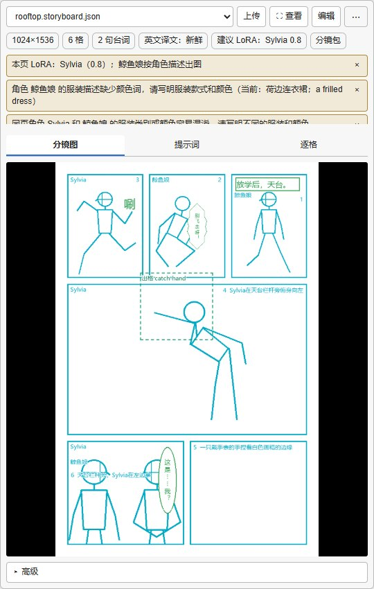
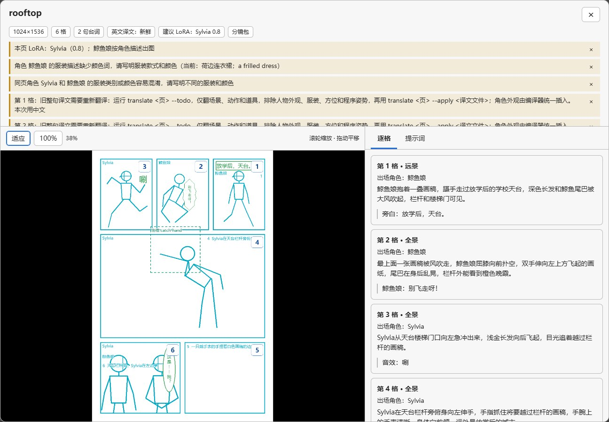
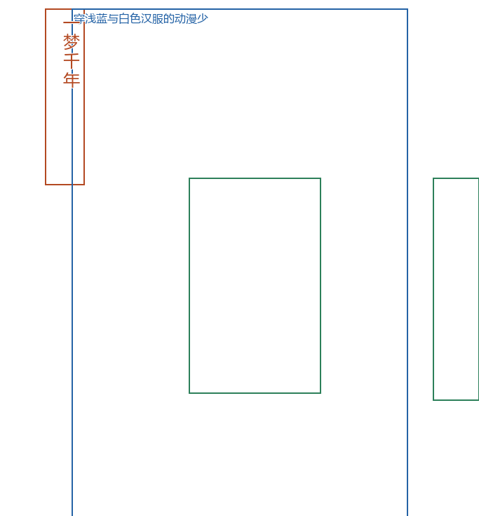

# ComfyUI-Soda-Storyboard

这个节点包让 ComfyUI 直接读取 Soda Storyboard 分镜包。你可以在节点里看草稿、核对提示词，再接着出整页图、重画局部和排字。

## 使用方法

从一页完整分镜开始最方便，下面用 `rooftop` 页举例。如果已经有分镜包或 MOSS JSON，装好以后可以直接从第 3 步开始。

这里使用的 **MOSS** 是按文字和位置框生成画面的图像模型；人物 **LoRA** 是可选的小模型，用来辅助保持角色外观。

1. 将本仓库放进 `ComfyUI/custom_nodes/ComfyUI-Soda-Storyboard`，再为 ComfyUI 使用的 Python 安装 soda-storyboard **0.4.0 或更高版本的 wheel**，然后重启。Windows 便携版命令在[安装](#安装)一节，模型文件需要自己准备。
2. 在 Claude Code / Codex 里定好分镜后，对插件说：“把 rooftop 页导出成分镜包，我要交给 ComfyUI。”它会调用 `export-bundle`，给你一个 `rooftop.storyboard.json`；自己用命令行导出也可以：

   ```powershell
   soda-storyboard export-bundle my-project/pages/rooftop.json --json
   ```

   命令结果会给出文件位置。还没做过分镜的话，可以从[中文使用说明](https://github.com/cOkieeman/soda-storyboard/blob/main/docs/guide/README.md)里的第一页教程开始。
3. 把 [minimal_page.json](example_workflows/minimal_page.json) 拖进 ComfyUI，打开已经接好线的整页示例。然后把分镜包拖到“导入分镜”的预览区，或点“上传”；拖到空白画布则会新建一个导入节点。
4. 导入后就能在“分镜图 / 提示词 / 逐格”中核对内容，点“查看”或分镜图可以放大。顶部列着尺寸、格数、台词数、译文状态和 LoRA 建议，有需要处理的地方会显示黄色提醒，这时还不需要运行采样。
5. 在 `UNETLoader`、`CLIPLoader`、`VAELoader` 的下拉框中重新选模型文件。示例只记了基本文件名，如果你放在子目录里，需要在列表里选到那个位置，文本编码器类型选 `moss_image`。
6. 要用人物 LoRA，就在原生 `LoraLoaderModelOnly` 里选文件和强度，一次一个；不用则旁路。默认示例由你手选 LoRA，导入节点给出的建议仅供参考，草稿、提示词和模型都看好以后，就可以点击 ComfyUI 运行了。



*导入节点预览组件，离线载入 draft 档实测分镜包。*

### 导入节点里看什么

顶部标签适合快速认一下文件：多大画布、几格、几句台词、英文译文是否可用、建议哪个 LoRA，以及这次导入的文件类型。下面的黄色提醒会把具体问题列出来，例如缺角色卡、服装容易混淆或尺寸来自推断。关闭一条提醒只是收起它，修改仍要回到分镜内容里做。

“分镜图”显示当前布局。分镜包和分镜单会重新画出火柴人草稿；MOSS JSON 则显示物件、角色和文字的位置框。切到“逐格”可以把描述、人物和台词放在一起对照，没有识别出格子的文件会显示“条目”，按文字、角色、物件分组。

“提示词”里是实际输出的完整 MOSS JSON，可以复制全文，也可以点“格式化”方便阅读，格式化不改变输出内容。

要改台词模式、斜切模式或自动触发词，展开“高级”。导入 MOSS JSON 时还会显示宽高，`0` 表示自动，填正数则覆盖文件尺寸。需要编辑内容时，点“编辑”打开工作副本，改好以后从“⋯ → 另存为新分镜包”下载，副本与原项目的关系见后文。

旧文件有一处需要留意：顶部译文标签可能显示“新鲜”，详细提醒却要求重译旧 `caption_auto_en` 缓存。遇到这种情况，以详细提醒为准，回插件按新规则补译。



*同一个 draft 档实测分镜包，在大窗口查看器中离线打开。左侧看整页，右侧看每格内容。*

在大窗口里滚轮缩放、拖动平移。点“适应”回到整页，点“100%”看原始尺寸；悬停右侧某一格，会高亮左侧对应区域。`Esc` 或点击遮罩关闭，`0` 适应窗口，`1` 恢复原始尺寸，方向键平移，`+` / `-` 缩放。右侧也能切到提示词，复制或格式化全文。

### 三种输入文件从哪里来

| 文件 | 来源与适合的用法 |
| --- | --- |
| 分镜包 `*.storyboard.json` | 插件或核心库 `export-bundle` 导出。带项目设置、分镜单和角色卡，适合从 AI 对话交接到 ComfyUI。优先用这个。 |
| 分镜单 `pages/<页id>.json` | 插件 / CLI 项目的单页文件，包含 `panels`。可以直接导入，但文件本身没有角色卡时，LoRA 和外观信息会缺失，节点会提醒。 |
| MOSS 布局 JSON | 从其他 AI、MOSS 工具或已有工作流取得，包含 `summary` 和 `items`。节点保留原始提示词，推断尺寸并显示位置框；它不一定是漫画，也可能是单张画布。 |



*外来直播界面 JSON 的布局预览局部，由 `moss_preview` 离线绘制。绿色为物件，蓝色为角色，橙色为文字。*

没有格子的 MOSS JSON 会标成“单画布”。这个示例的尺寸回退为 `1024×1536`，部分框超出画布，在预览里被裁切，原始 bbox 仍保留。如果比例和原稿不符，可以到“高级”里填写宽高。尺寸和格子识别都可能来自推断，复杂重叠或描述中的“格”字有时也会被误读，因此导入后仍要对照原稿看一下。

### 三个示例怎么选

| 示例 | 什么时候用 | 流程与要检查的地方 |
| --- | --- | --- |
| [minimal_page.json](example_workflows/minimal_page.json) | 第一张整页图，或分镜已经定好后重新出整页。 | 导入 → MOSS 采样 → 斜切裁剪 → 排字 → 保存。默认 shift 5、25 步、CFG 2.5，采样器 `er_sde`，调度器 `simple`。 |
| [panel_redraw.json](example_workflows/panel_redraw.json) | 已有整页图，只想修一格。 | 载入整页 → 切格 → 图生图 → 贴回 → 保存。先选好整页图片和格子，默认降噪 `0.45`。 |
| [character_swap.json](example_workflows/character_swap.json) | 想对某个角色所在区域做局部重绘。 | 切格 → 人物遮罩 → 局部重绘 → 按同一遮罩合成回原格 → 贴回。切格与遮罩的格子必须一致，默认降噪 `0.85`。需要角色 LoRA 时在原生 Loader 中手选。 |


*minimal_page 在真实 ComfyUI 中的连线。为便于看全图，临时整理了节点位置，截图时尚未导入分镜包或运行采样。*

三个模板使用的都是本包和 ComfyUI 核心节点，ComfyUI 版本需要支持 `moss_image` 文本编码器与 `EmptyFlux2LatentImage`。打开修格模板后，除了选好模型、VAE 和需要的 LoRA，还要载入已有的整页图片；采样由你点击运行后才开始。

## 安装

需要 Python 3.12+ 和支持 MOSS 的新版 ComfyUI。[soda-storyboard 核心库](https://github.com/cOkieeman/soda-storyboard)单独安装，模型也需要另外准备。

### Windows 便携版

将本仓库放入 `ComfyUI/custom_nodes/ComfyUI-Soda-Storyboard`。在 `ComfyUI_windows_portable` 根目录，用便携版自己的 Python 安装 wheel，再重启 ComfyUI：

```powershell
.\python_embeded\python.exe -m pip install --upgrade "https://github.com/cOkieeman/soda-storyboard/releases/download/v0.4.0/soda_storyboard-0.4.0-py3-none-any.whl"
```

也可以安装本仓库已经指向同一 wheel 的依赖文件：

```powershell
.\python_embeded\python.exe -m pip install -r .\ComfyUI\custom_nodes\ComfyUI-Soda-Storyboard\requirements.txt
```

便携版用 wheel 可以省掉源码构建这一步。它的内嵌 Python 有 `._pth` 隔离设置，从 Git 安装源码包时可能找不到构建后端 `uv_build`。如果遇到 `BackendUnavailable: Cannot import 'uv_build'`，检查是否装成了 Git 源码依赖，改用上面的 wheel 即可。

### 普通 Python 环境与 Manager

在 ComfyUI 使用的虚拟环境中，进入节点包目录后安装依赖，再重启：

```powershell
python -m pip install --upgrade -r requirements.txt
```

也可在 ComfyUI Manager 中用 [本仓库 Git URL](https://github.com/cOkieeman/ComfyUI-Soda-Storyboard) 安装。若 Manager 没有替 ComfyUI 的 Python 安装 `requirements.txt`，再按上面的对应环境补装。Registry 发布和 Manager 索引收录是另外的步骤。

torch、numpy 使用 ComfyUI 环境已有的版本；Pillow 由核心库提供。缺少核心库时，节点仍会注册，运行需要它的节点时会给出安装提示。低于 0.4.0 时，ComfyUI 控制台会提示升级命令。

### 准备 MOSS 模型

| 用途 | 示例文件名 | ComfyUI 目录 |
| --- | --- | --- |
| SFT 主模型 | `moss_image_sft_int8_convrot.safetensors` | `models/diffusion_models` |
| 文本编码器 | `qwen3.5_9b_w4a8_gptq.safetensors`，类型 `moss_image` | `models/text_encoders` |
| VAE | `flux2-vae.safetensors` | `models/vae` |
| 可选角色 LoRA | 自己使用的角色 LoRA | `models/loras` |

示例工作流使用 SFT。模型可以放在子目录中，在 Loader 的下拉列表里选到实际文件就行。核心插件的检查命令、Base / SFT 配置及更多安装说明见[安装章](https://github.com/cOkieeman/soda-storyboard/blob/main/docs/guide/02-installation.md)。

## 节点一览

节点都在 **Soda Storyboard** 分类下。第一张图可以直接使用示例中的“导入分镜”，后面需要修格子或排字时，再查对应节点。

| 节点 | 用来做什么 |
| --- | --- |
| 导入分镜 · `SodaLoadStoryboard` | 上传分镜包、分镜单或 MOSS JSON，查看预览，输出提示词、尺寸、页面快照和草稿图。 |
| 链接分镜项目（进阶）· `SodaLoadStoryboardPage` | 直接读本机项目，项目保存后更新预览，下次运行重新编译。 |
| 加载分镜 LoRA · `SodaLoadStoryboardLoRA` | 按输入的 LoRA 名称和强度加载一个 LoRA，名称为空时直接传回原模型。 |
| 载入 MOSS JSON · `SodaLoadMossJSON` | 为旧工作流或粘贴文本保留的入口；新文件导入用“导入分镜”。 |
| 分镜草稿图 · `SodaStoryboardPreview` | 把页面或上游页面快照画成火柴人草稿。 |
| 切格 · `SodaCropPanel` | 按格子裁图，并输出遮罩、单格提示词和贴回需要的位置。 |
| 人物遮罩 · `SodaCharacterMask` | 按所选格子与角色生成局部重绘遮罩。 |
| 贴回格子 · `SodaPastePanel` | 把修好的格子放回整页，按原格尺寸与斜边合成。 |
| 斜切裁剪 · `SodaCutQuads` | 按分镜四边形裁出斜切格并画格框。 |
| 排字 · `SodaLetterPage` | 给程序排字模式的文字绘制气泡与文字。 |
| 参考图生成版式 · `SodaExtractLayout` | 从参考页识别格子，输出预览，并可保存为项目版式模板。 |

### 主要输出怎么接

“导入分镜”输出以下内容；“链接分镜项目”保留前八个输出，不带 `draft`。

| 输出 | 接到哪里 |
| --- | --- |
| `moss_json` | MOSS 的 JSON 文本输入，直接传入，不再套一层引号。 |
| `width` / `height` | latent 的宽高等整数输入。 |
| `resolution_json` | 接受 `{"version":1,"width":W,"height":H}` 的分辨率节点。 |
| `lora_name` / `lora_strength` | 可选的 LoRA 建议；默认模板没有把它们自动接到 Loader。 |
| `negative` | 负面文本编码器。 |
| `page_info` | 切格、人物遮罩、贴回、斜切裁剪和排字使用的页面快照。 |
| `draft` | `PreviewImage` 等图像节点；与节点里看到的是同一张草稿，最长边不超过 1024。 |

接已有 Soda-MOSS 工作流时，把原 JSON 文本输出线改接 `moss_json`，再接回原来的下游输入。需要时将分辨率节点的控件右键转为输入，接 `resolution_json`，或直接接两个宽高整数。解码后按需接“斜切裁剪 → 排字 → 保存图像”，它们的 `page_info` 都来自导入节点。

默认示例中，`UNETLoader → LoraLoaderModelOnly → ModelSamplingAuraFlow`。如果你明确要自动采用角色卡建议，可以自己把原生 Loader 换成“加载分镜 LoRA”，连接模型、`lora_name` 和 `lora_strength`；找不到 LoRA 文件会报错。

## 导入副本、编辑与链接项目

上传文件会在 ComfyUI 的 `input/soda-storyboard/` 中保存一份副本，插件中的原项目保持原样。所以在插件里改了分镜，需要重新导出、上传。三种输入都能在采样前预览。

分镜包和分镜单的草稿会由核心库重新渲染，显示的是当前内容，而不是包里的旧缩略图。页面中明确填写的设置优先于项目默认值。分镜包格式为 `soda-storyboard-bundle-v1`，包含 `project`、`page`、`characters`，也可带导出时间和缩略图。

点“编辑”后，节点会在导入目录下建立工作项目并打开侧边栏编辑器。保存后约 1.5 秒内，节点刷新草稿与最终提示词；下次运行用保存后的内容。改完后点“⋯ → 另存为新分镜包”，下载新文件，原上传文件不会被覆盖。关闭侧边栏不会停止编辑器服务；需要停止时点侧边栏的“停止本项目编辑器”。

MOSS JSON 的编辑入口会提示“转换为分镜单后编辑”。确认后才近似转换：物件 / panel 框转成格子，文字转成文字框，caption 转成描述。人物只保留框和描述，原斜边、关节等信息不能完整还原，复杂布局需要手动调整。未经转换时，MOSS JSON 原样送入采样流程。

经常在插件和 ComfyUI 两边来回改，可以使用“链接分镜项目”。填好项目目录，点“记住项目”，再从下拉列表选页；目录会记在当前浏览器中。页面、角色卡或项目设置变化后，预览随之更新，下次运行时重新编译。项目结构如下：

```text
my-project/
  project.json
  pages/
    rooftop.json
  characters/
    hero.json
```

链接节点读取的是 ComfyUI 所在电脑的目录。侧边栏编辑器只支持浏览器与 ComfyUI 在同一台电脑、同源访问的情况；远程浏览器或不同来源的反向代理不能使用 iframe 入口。上传文件上限为 16 MiB。

## 修格子与排字时要注意

- **图像尺寸要和分镜画布一致。** 尺寸不符会报错，先核对整页宽高再接后处理。
- **切格和人物遮罩要选同一格。** 下拉按阅读顺序列出格子，角色列表跟着所选格子变化。旧工作流中的数字仍按从 1 开始的阅读序号处理。
- **人物遮罩的范围要配合输入。** 输入切出的单格，范围选“格子”；输入完整页面，选“整页”。默认外扩 24px、羽化 16px，单位是原分镜画布像素。遮罩会避开同格另一角色的区域。
- **贴回默认保护文字。** 单格会恢复到原格尺寸，再按斜边贴回。多候选批量处理支持同数量配对，或其中一边只有一张。
- **切格提示词只描述一格。** 输出固定带无格框、无沟槽、无文字和无气泡等限制，不会附上整页布局前缀。
- **排字只处理程序排字的文字。** 台词模式可以跟随页面、强制 MOSS 画字或强制程序排字。中文字体建议用思源黑体或 Noto Sans CJK，也可以在排字节点指定字体文件。
- **参考图保存模板后关掉保存开关。** 开关打开时，每次排队都会写一份新模板；先检查识别预览和提醒，再使用模板。

## LoRA 与外来 JSON 的边界

角色卡的 LoRA 路径应相对于 `models/loras`，例如 `characters/hero.safetensors`。节点预览不会加载 LoRA；多个角色都带 LoRA 时会提醒一次只加载一个，但仍允许编译。默认示例由你在原生 Loader 中手选。

“提示词包含触发词”默认开启，会把出场角色的触发词放进对应格子的描述。关闭时只省去自动添加的触发词，角色外观仍保留；手写在描述里的内容不会被删除。这个开关不改变核心插件 / CLI 的自动出图策略。

外来 MOSS JSON 支持核心库接受的中心、左上角、0～1、0～1000 坐标，以及 yxyx / xyxy / xywh 格式。宽高自动推断不一定知道原始比例，尤其是归一化坐标或空条目；检查预览后再定尺寸。格子识别只是辅助显示，复杂布局请保留原始 JSON，别只凭识别结果判断提示词是否正确。

更多角色卡写法、服装区分、中文翻译、编辑器和排错，见[完整中文使用说明](https://github.com/cOkieeman/soda-storyboard/blob/main/docs/guide/README.md)。分镜交给其他 AI 时，可以附上核心库的 [for-other-ai.md](https://github.com/cOkieeman/soda-storyboard/blob/main/docs/for-other-ai.md)；程序接入看 [bundle-api.md](https://github.com/cOkieeman/soda-storyboard/blob/main/docs/bundle-api.md)。

## 开发与验证

已有开发依赖时，可运行格式检查、静态检查、Python 测试和前端测试：

```powershell
uv run ruff format --check .
uv run ruff check .
uv run pytest
node --test tests/*.mjs
```

离线验证可使用现有 `.venv`，并让 `PYTHONPATH` 指向相邻核心仓库的 `src`。不要让开发环境的路径依赖替代 ComfyUI 正式安装的 wheel。Python 测试覆盖几何、编译、文字保护、草稿、参考图识别、路由访问控制和编辑器生命周期；缺少 torch 时会跳过张量相关测试。前端测试使用模拟 DOM / API，模型出图仍需在实际 ComfyUI 环境检查。

## English

Load a Soda Storyboard bundle, bare page JSON or MOSS layout JSON into ComfyUI. Inspect the draft, warnings and exact final MOSS JSON before running a workflow. Three examples cover full-page generation, panel redraw and masked character edits. Select model files and an optional character LoRA in the native loaders. Requires Python 3.12+, a MOSS-capable ComfyUI and the prebuilt soda-storyboard 0.4.0+ wheel. See the [Chinese guide](https://github.com/cOkieeman/soda-storyboard/blob/main/docs/guide/README.md) for the complete workflow.

## License

Apache-2.0. The separately installed soda-storyboard library and model files retain their own licenses.
