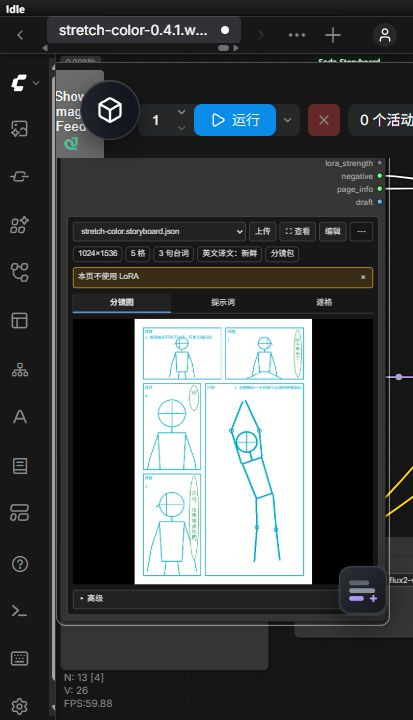
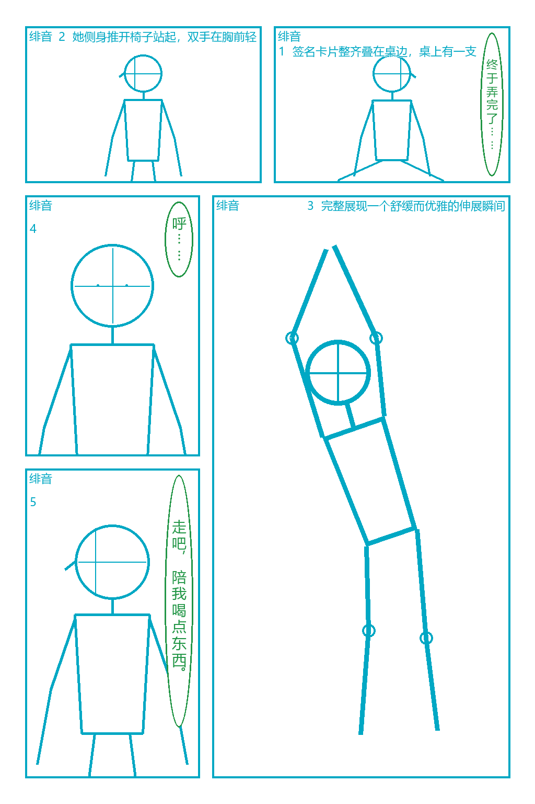
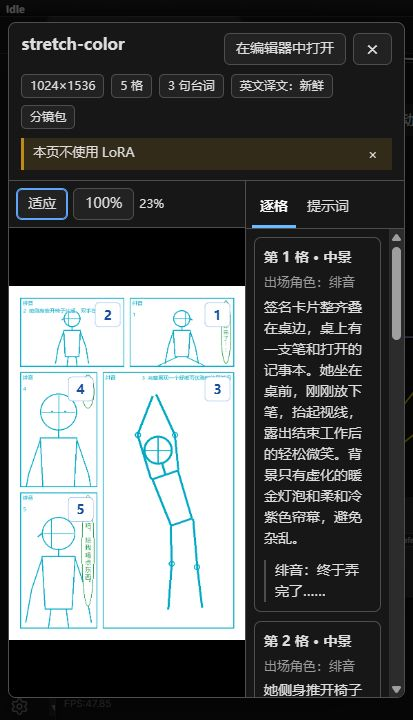
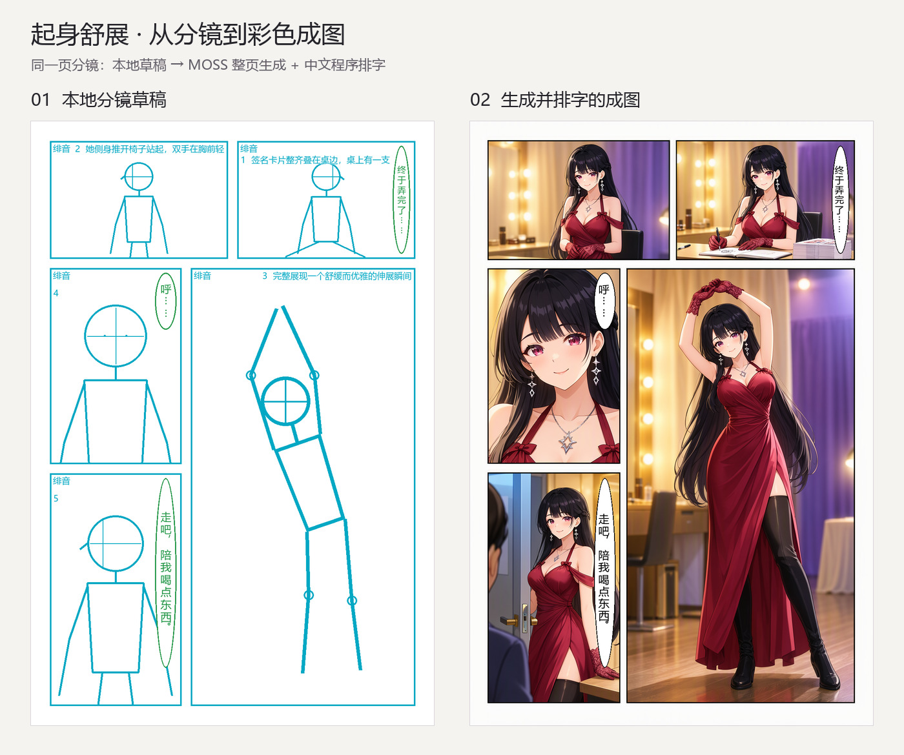

# 用这张彩色漫画跑通 Soda Storyboard 节点


这章就用上面这张实测成图，从导入分镜、检查提示词，到手动运行和中文排字，走完一次节点流程。配套文件都在本仓库里，第一次使用可以直接加载，再尝试改成自己的故事。

主角是 25 岁的原创成年女性绯音：黑色长发、齐刘海、红紫色眼睛，穿酒红色礼服、蕾丝手套和黑色长靴。画面用暖金灯光与冷紫色帘幕衬托人物，右侧竖向主格完整展示举臂舒展的姿态。这次通过**文字提示词**描述角色，没有图片输入，也没有角色 LoRA。

## 1. 准备节点、模型和示例文件

先按 [README 的安装说明](../README.md#安装)装好节点。本教程使用 **soda-storyboard 核心库 0.4.1 或更高版本**，安装在 ComfyUI 实际使用的 Python 环境里，然后重启 ComfyUI。

Windows 便携版可以在 `ComfyUI_windows_portable` 根目录执行：

```powershell
.\python_embeded\python.exe -m pip install --upgrade soda-storyboard
```

下载本仓库后，本章主要用到以下文件。模型需按安装说明另外准备。

| 文件 | 用途 |
| --- | --- |
| [stretch-color.json](../example_workflows/stretch-color.json) | 在 ComfyUI 中打开的节点工作流 |
| [stretch-color.storyboard.json](../examples/stretch-color/stretch-color.storyboard.json) | 上传到“导入分镜”节点的单文件分镜包 |
| [pages/stretch-color.json](../examples/stretch-color/pages/stretch-color.json) | 可编辑的原始分镜页，含格子、人物姿势与文字框 |
| [characters/hiyone.json](../examples/stretch-color/characters/hiyone.json) | 绯音的中英文角色卡 |
| [output/character-prompt.txt](../examples/stretch-color/output/character-prompt.txt) | 本次使用的角色英文描述 |

在 ComfyUI 按 `Ctrl+O` 打开 `example_workflows/stretch-color.json`，也可以把工作流 JSON 拖到空白画布。通过 GitHub 单独下载文件时，使用页面上的 **Raw / Download raw file** 保存 JSON 原文。

工作流和分镜包是两个文件：先打开工作流，接着上传分镜包。

## 2. 上传分镜包，先看懂这一页

在“导入分镜”节点点击“上传”，选择 `examples/stretch-color/stretch-color.storyboard.json`；也可以把它拖到节点的预览区。配套工作流留空了上传文件选择，所以这一步需要自己完成。



导入后先核对顶部信息：**1024×1536、5 格、3 句台词、英文译文新鲜、本页不使用 LoRA**。这里查看草稿和提示词不需要运行采样。



阅读顺序从右上到左下。上方先读右格、再读左格，随后看右侧竖向大格，最后读左侧的上下两格：

| 顺序 | 画面安排 | 台词 |
| --- | --- | --- |
| 1 | 签完最后一张卡片，放下笔，露出轻松的笑容 | 终于弄完了…… |
| 2 | 推开椅子起身，双手轻轻交握，准备舒展 | — |
| 3 | 双臂举过头顶，身体自然伸长，以完整全身作为主画面 | — |
| 4 | 放松后的脸部特写，轻轻呼气 | 呼…… |
| 5 | 看向门边的同伴，笑着发出邀请 | 走吧，陪我喝点东西。 |

青色人物是构图和姿势示意，绿色框是独立的文字对象。骨架帮助表达人物的取景、朝向与动作；模型实际接收文字描述和位置框，手腕如何相搭、视线与表情等细节也写在逐格描述里。

## 3. 检查人物、动作和最终提示词

切到“逐格”，可以把每格画面、角色与台词放在一起检查。切到“提示词”，看到的是节点实际输出的完整 MOSS JSON；“格式化”只调整显示方式，“复制”可以取得全文。

点“查看”或节点里的分镜图，打开大窗口。左侧看整页，右侧核对逐格内容；滚轮缩放、拖动平移，“适应”回到整页。



这次人物效果主要来自三部分：

- **角色卡固定外观。** 黑长发与齐刘海、红紫眼、酒红礼服、蕾丝手套、黑长靴和星形耳坠，在各格共用同一份描述。
- **逐格描述安排动作。** 主格写明抬臂、轻微转身、肩髋自然错位、一腿承重，并给指尖和靴尖留足空间。
- **页面画风统一质感。** 彩色二维动漫、细线、柔和赛璐珞与渐变上色，配合暖金与冷紫灯光。

想换成自己的角色，先改角色卡的外观和服装，再改各格动作；故事不变时，可以保留现有格框与文字位置。完整编译结果也可在 [stretch-color.moss.json](../examples/stretch-color/output/stretch-color.moss.json) 中查看。

## 4. 在 Loader 中选本机模型

在三个原生 Loader 的下拉列表里重新选择本机文件。模型可以放在子目录中，选中列表里实际存在的那一项即可。

| 节点 | 本次使用的文件或设置 |
| --- | --- |
| `UNETLoader` | `moss_image_sft_int8_convrot.safetensors` |
| `CLIPLoader` | `qwen3.5_9b_w4a8_gptq.safetensors`，类型选 **`moss_image`** |
| `VAELoader` | `flux2-vae.safetensors` |

本工作流没有 LoRA Loader。导入节点的 `moss_json` 接正面文本编码，`negative` 接负面文本编码，`width` / `height` 接 latent 尺寸；`page_info` 接后面的排字节点。

确认以下参数后，将批次数量保持为 **1**，手动点击 ComfyUI“运行”：

| 参数 | 本次设置 |
| --- | --- |
| 画布 | 1024×1536 |
| `ModelSamplingAuraFlow` shift | 5 |
| `KSampler` 种子 | `20261022`，`fixed` |
| 步数 / CFG | 50 / 3 |
| 采样器 / 调度器 | `euler` / `simple` |
| 降噪 | 1 |
| `SkipLayerGuidanceDiTSimple` | 单层 `22`，start 0、end 1 |
| `EmptyFlux2LatentImage` batch size | 1 |

本次在我们的机器上完整执行约 **102.5 秒**。这只是本机记录；模型版本、硬件和运行环境会影响耗时与生成结果，相同种子也不保证逐像素一致。

## 5. 看排字和保存结果

本页采用程序排字，图像部分完成后再加入三句中文台词：

```text
MOSS 采样 → VAE 解码 → 排字 SodaLetterPage → 保存图像 SaveImage
```

这页五格都是矩形，工作流保留模型生成的格框，解码后直接接排字。这里没有接“斜切裁剪” `SodaCutQuads`，避免再画一套边框。



在最后的“保存结果”节点或 ComfyUI 任务历史里查看成图。`SaveImage` 会把 PNG 保存到 ComfyUI 的 `output` 目录。

排字节点会尝试寻找中文字体；如果文字缺失或字体报错，在 `SodaLetterPage` 的字体字段填写本机可用的中文字体文件路径，例如思源黑体或 Noto Sans CJK。

看图时先检查主格人物的指尖、头顶和靴尖是否完整，手部与双臂是否自然，再看各格脸型、发型和服装是否一致，以及气泡有没有挡住脸。本次第 2 格仍偏坐姿，和“推开椅子站起”的描述不完全一致；它说明分镜描述能引导画面，具体动作仍需看生成结果。

## 6. 改一处，再导出自己的版本

点击导入节点的“编辑”，可打开这份上传副本的网页编辑器。点格子改描述，点人物调姿势和朝向，点文字改台词或位置。等页面显示保存完成后，节点通常会在约 1.5 秒内刷新草稿与提示词；下次运行使用保存后的内容。

可以先做一个小改动，例如把最后一句台词换成自己的话，或微调最后一格的文字框位置。改完点 **“⋯ → 另存为新分镜包”**，下载修改后的文件，便于下次继续使用。

上传时会在 ComfyUI 的 `input/soda-storyboard/` 下保存副本。节点编辑的是工作副本；随仓库附带的项目源文件是另一份。如果在插件中改了原项目，需要重新导出，再上传新包。关闭编辑器侧栏后，后台服务仍会运行，需要时点击侧栏的“停止本项目编辑器”。

### 可选：让插件修改原项目

如果已经安装 Soda Storyboard 的 Codex / Claude Code 插件，可以把 `examples/stretch-color/` 复制为自己的故事目录，再对插件说：

> 用 soda-storyboard 修改这个项目。保留彩色画风、绯音的外观和五格版式，第二格让起身动作更明确，第三格保留完整全身。先给我看更新草稿，确认后补译并导出分镜包，我自己在 ComfyUI 运行。

项目里的 `project.json` 保存默认设置，`characters/hiyone.json` 保存固定外观，`pages/stretch-color.json` 保存当前页面。改画面描述后需要补齐新的英文场景译文；改角色卡外观后，编译器会自动读取新外观。

手动操作时，以下命令从**本节点仓库根目录**运行，需要已安装核心 CLI：

```powershell
soda-storyboard translate examples/stretch-color/pages/stretch-color.json --todo --json
```

让插件 AI 根据待办里的最新 `source_hash`，只翻译场景、动作和道具，并写入 `examples/stretch-color/translations.json`。角色外观由角色卡插入，中文台词保留原文。准备好译文文件后执行：

```powershell
soda-storyboard translate examples/stretch-color/pages/stretch-color.json --apply examples/stretch-color/translations.json --json
soda-storyboard validate examples/stretch-color/pages/stretch-color.json --json
soda-storyboard export-bundle examples/stretch-color/pages/stretch-color.json --output examples/stretch-color/stretch-color.storyboard.json --json
```

把新导出的 `stretch-color.storyboard.json` 上传到导入节点，再检查预览与译文状态，最后由你点击运行。导出分镜包本身不会提交生成任务。

[返回节点 README](../README.md) · [更多分镜、角色与编辑器用法](https://github.com/cOkieeman/soda-storyboard/blob/main/docs/guide/README.md)
